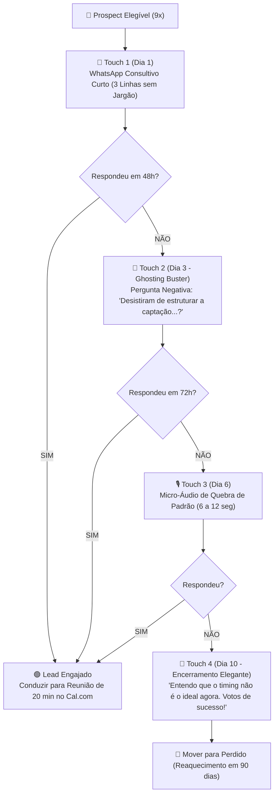

# RevOps Follow-Up System — Cadência de Aceleração de Pipeline

Este manual estabelece as regras de cadência e transição de etapas para o **Jonh (Gerente Geral de Operações)**, garantindo que nenhum negócio estagne no CRM e que todos os leads recebam o acompanhamento no tempo correto.

---

## 1. As Janelas Temporais de Follow-Up (Regra dos Prazos)

O Jonh fiscaliza a passagem do tempo em cada etapa aberta do pipeline:

| Etapa no CRM | Prazo Máximo sem Resposta | Ação Imediata do Jonh |
| :--- | :--- | :--- |
| **Prospect** (`03f4795a-...`) | 24 horas após inserção | Libera Touch 1 consultivo (se estiver dentro do teto diário de 5-10 e horário de Lisboa). |
| **Lead (1 Msg Enviada)** | 48 a 72 horas | Se o lead não respondeu, aciona o **Ghosting Buster** (pergunta de Chris Voss + micro-áudio de quebra de padrão). |
| **Lead Engajado (Contacted)** | 24 horas | Se respondeu positivamente, aciona o **Closer** para agendamento direto no Cal.com do Philipe. |
| **Reunião Agendada** | 24h e 2h antes | Aciona o **Anti No-Show** para envio de lembrete de confirmação com link do Google Meet / Cal.com. |

---

## 2. A Cadência Multicanal em 3 Níveis

---

## 3. As 3 Regras Invioláveis do Jonh no CRM

1. **Idempotência e Histórico Obrigatório**:
   * Toda e qualquer ação de follow-up (seja mensagem de WhatsApp, e-mail ou mudança de status) DEVE registrar um registro em `activities` (com status `completed`) e uma linha em `deal_logs`.
2. **Próximo Passo Ininterrupto**:
   * Um lead em aberto NUNCA pode ter zero atividades pendentes. Se uma atividade é concluída, a próxima deve ser agendada imediatamente com data e hora.
3. **Respeito aos Limites Anti-Bloqueio**:
   * O Jonh nunca força mais de 10 envios frios por dia e bloqueia qualquer disparo automático após as 18h00 ou em fins de semana em Portugal.
