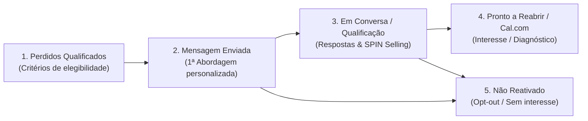

# DOSSIÊ COMPLETO DE OPERAÇÃO: SDR VAMUSS & AGENTE COMERCIAL AUTÓNOMO
**Módulo: Reaquecimento de Leads Perdidos | Versão de Produção 2.0**
*Documento Estratégico, Funcional e Técnico para Validação e Auditoria Operacional*

---

## 1. INTRODUÇÃO E VISÃO GERAL

O módulo **Reaquecimento de Leads Perdidos** da Vamuss não é um disparador em massa nem uma automação tradicional de "disparo de mensagens". Trata-se de um **colaborador digital comercial autónomo (SDR + Closer)** dotado de inteligência estratégica, memória de relacionamento, navegação web em tempo real e capacidade de conduzir conversas consultivas pelo WhatsApp.

### O Princípio Central:
> **"Não vender anúncios. Vender uma solução para um problema empresarial real que a aquisição de clientes ajude a resolver."**

O agente tem como mandato reabrir canais de contacto com clínicas e profissionais de saúde que foram perdidos no passado, filtrar os que têm potencial, qualificar as dores reais com a metodologia **SPIN Selling**, contornar objeções e conduzir o lead até ao agendamento de uma **Reunião de Diagnóstico de 20 minutos** no Cal.com do Philipe.

---

## 2. A ARQUITETURA DO MENU: SDR WORKSPACE & KANBAN DE RECUPERAÇÃO

No CRM da Vamuss, o menu **SDR Vamuss / Reaquecimento** organiza-se em duas vistas operacionais complementares:

```
┌────────────────────────────────────────────────────────────────────────┐
│                        SDR WORKSPACE (VAMUSS)                          │
├─────────────────────────────────────┬──────────────────────────────────┤
│         VISTA 1: QUADRO KANBAN      │     VISTA 2: POSTO DE COMANDO    │
│  (Gestão visual dos 5 estágios do   │  (Auditoria deal a deal, fila de │
│    fluxo de reativação de leads)    │   tarefas, logs e métricas IA)   │
└─────────────────────────────────────┴──────────────────────────────────┘
```

### Os 5 Estágios do Pipeline de Reativação:



1. **Perdidos Qualificados:**
   * Negócios com status `lost` no Supabase que cumpriram rigorosamente todos os critérios de triagem: perda há mais de 30 dias, telemóvel móvel português válido (rede 9), sem pedido de opt-out prévio, e excluindo terminantemente ex-clientes contratuais (ex: Odontoclinic) ou franquias fora do perfil.
2. **Mensagem Enviada:**
   * Leads que já receberam a 1ª mensagem de reaquecimento humano criada exclusivamente para o seu caso. Ficam em acompanhamento de silêncio, aguardando resposta.
3. **Em Conversa / Qualificação:**
   * A clínica respondeu no WhatsApp. O agente assume o papel de **Closer Consultivo**, interpretando dúvidas, objeções e aprofundando necessidades.
4. **Pronto a Reabrir / Diagnóstico Marcado:**
   * A clínica demonstrou interesse em compreender o método. O link do Cal.com foi enviado ou a reunião foi agendada.
5. **Não Reativado:**
   * Leads que responderam expressando desinteresse ou pedindo paragem de contacto. São imediatamente protegidos por RGPD e nunca mais importunados.

---

## 3. O COLABORADOR AUTÓNOMO: COMO ELE TRABALHA SOZINHO

O agente opera através de um loop autónomo contínuo com arquitetura **OpenAI Function Calling (GPT-4o)** alimentado pela **Constituição Comercial da Vamuss**. Ele atua em dois ciclos distintos:

```
┌───────────────────────────────────────────────────────────────────────┐
│                    CICLO 1: SDR PROATIVO (OUTBOUND)                   │
│   Varre o CRM ➔ Pesquisa a Clínica na Web ➔ Elabora Mensagem ➔ Dispara│
└───────────────────────────────────┬───────────────────────────────────┘
                                    │ (Clínica Responde)
┌───────────────────────────────────▼───────────────────────────────────┐
│                    CICLO 2: CLOSER REATIVO (INBOUND)                  │
│  Lê Contexto ➔ Aplica SPIN Selling ➔ Quebra Objeção ➔ Envia Cal.com   │
└───────────────────────────────────────────────────────────────────────┘
```

---

### CICLO 1: A Prospeção Proativa (Outbound Humano Espaçado)

Para proteger a integridade do número do telemóvel do Philipe (+351 964 094 865) e evitar qualquer comportamento de robô ou spam, o agente não envia mensagens em bloco. Trabalha com uma **cadência espaçada em 4 janelas diárias (Segunda a Sexta-feira)**:

* **Slot 1 (10h15):** 2 novos leads (arranque da manhã nas clínicas).
* **Slot 2 (12h30):** 1 novo lead (janela de intervalo de almoço).
* **Slot 3 (15h15):** 1 novo lead (meio da tarde).
* **Slot 4 (16h40):** 1 novo lead + toques de seguimento.
* **Slot 5 (17h30):** Envio do **Resumo Diário Operacional** para o WhatsApp do Philipe.

#### Passo a passo do que o agente faz em cada disparo:
1. **Varredura Inteligente (`scan_crm_lost_deals`):** Seleciona o próximo negócio elegível do funil de perdidos.
2. **Dossiê Profundo (`fetch_lead_full_dossier`):** Lê os motivos da perda anterior, as notas do Philipe e o histórico de mensagens antigas.
3. **Pesquisa Web em Tempo Real (`research_clinic_online`):** Acede à internet para ler o website da clínica, tratamentos principais (ex: Invisalign, implantologia, harmonização) e a localização da clínica.
4. **Construção da Mensagem Sob Medida:**
   * NUNCA usa templates fixos nem linguagem engessada.
   * Respeita a regra de **Português de Portugal**.
   * Não desmerece agências anteriores nem equipas internas.
   * Não vende serviços nem solicita reuniões logo na primeira frase.
   * Conclui com uma pergunta aberta, cordial e fácil de responder.
5. **Disparo Real via WhatsApp Web:** Envia a mensagem a partir da sessão real do WhatsApp conectada na agência.

---

### CICLO 2: O Tratamento de Respostas (Closer Autónomo Inbound)

Quando qualquer clínica responde (seja por mensagem escrita ou nota de voz):

1. **Reconhecimento & Transcrição:** Se for áudio, o áudio é descarregado e transcrito automaticamente via **OpenAI Whisper**.
2. **Triagem de Segurança (Filtro Anti-Intrusão):**
   * O sistema confere se o número pertence a um negócio em acompanhamento no CRM.
   * Números pessoais, amigos, família ou contactos sem relação comercial são **100% ignorados** pelo agente para proteger a privacidade do Philipe.
3. **Interpretação Estratégica (SPIN Selling):**
   * **Se o lead disser que não quer / sem interesse:** O agente ativa de imediato a ferramenta `register_opt_out`, bloqueia o contacto por RGPD na lista de supressão e move o cartão para `nao_reativado`.
   * **Se o lead tiver dúvidas ou objeções ("Já temos equipa", "Quanto custa?", "Como funciona?"):** O agente elabora uma resposta curta e empática ancorada nas diretrizes da Constituição:
     * *Objeção de preço:* Ancorado no valor de **197 €/mês**, reposiciona o foco: uma única reabilitação ou tratamento de alto valor cobre vários meses de investimento.
     * *Objeção de equipa/agência existente:* Elogia a estrutura atual e pergunta como tem sido o retorno em tratamentos de maior valor.
   * **Se o lead demonstrar abertura ou dor:** Apresenta a Reunião de Diagnóstico de 20 minutos e envia o link direto do Cal.com.

---

## 4. AS SALVAGUARDAS E BLINDAGENS OPERACIONAIS

Para permitir que o colaborador opere com total independência e sem necessidade de supervisão constante, foram implementados 6 sistemas de blindagem:

```
┌────────────────────────────────────────────────────────────────────────┐
│                   AS 6 BLINDAGENS DE AUTONOMIA TOTAL                   │
├──────────────────────────┬─────────────────────────┬───────────────────┤
│ 1. Horário Comercial     │ 2. Limite de Segurança  │ 3. Trava de       │
│    (09h-17h Lisboa)      │    (Máximo 5 leads/dia) │    Amnésia        │
├──────────────────────────┼─────────────────────────┼───────────────────┤
│ 4. Isolamento Pessoal    │ 5. Circuit Breaker      │ 6. RGPD &         │
│    (Zero risco pessoal)  │    (Travão de queixas)  │    Opt-Out Rígido │
└──────────────────────────┴─────────────────────────┴───────────────────┘
```

1. **Janela Comercial Rígida:** Nenhum lead é abordado fora do horário das 09h00 às 17h00 (dias úteis em Portugal).
2. **Teto de Disparos:** Máximo de 5 novos contactos por dia para manter a abordagem cirúrgica e o telemóvel 100% seguro contra bloqueios.
3. **Memória Temporal (Anti-Amnésia):** Proibição matemática de o agente fingir que nunca falou com a clínica se houve contacto nas últimas 48h a 72h.
4. **Isolamento de Contactos Pessoais:** O agente só processa mensagens de números com negócios expressamente registados como perdidos no CRM.
5. **Circuit Breaker Preventivo:** Se ocorrerem 2 recusas agressivas no mesmo dia, todos os disparos frios são suspensos preventivamente até ao dia seguinte.
6. **Cumprimento Estrito de RGPD:** Ao menor sinal de recusa, o número é bloqueado e não volta a ser importunado.

---

## 5. COMO AUDITAR E ACOMPANHAR O TRABALHO DO AGENTE

A qualquer momento, o Philipe ou a equipa podem auditar o trabalho do colaborador através de 3 mecanismos:

1. **No WhatsApp do Philipe:** Alertas instantâneos são enviados assim que um link de diagnóstico é partilhado, e um resumo consolidado é entregue diariamente às 17h30.
2. **No SDR Workspace (Quadro Kanban):** É possível ver em que estágio cada clínica está, ler o histórico de notas, ver a data do último contacto e intervir manualmente se necessário.
3. **Na Barra Superior de Métricas:** Contador em tempo real das mensagens enviadas hoje, total de respostas recebidas e reuniões geradas.
