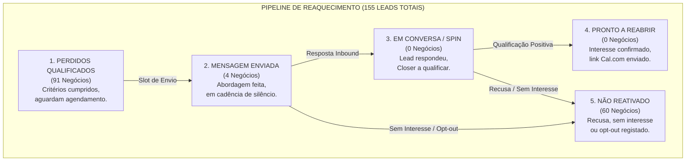
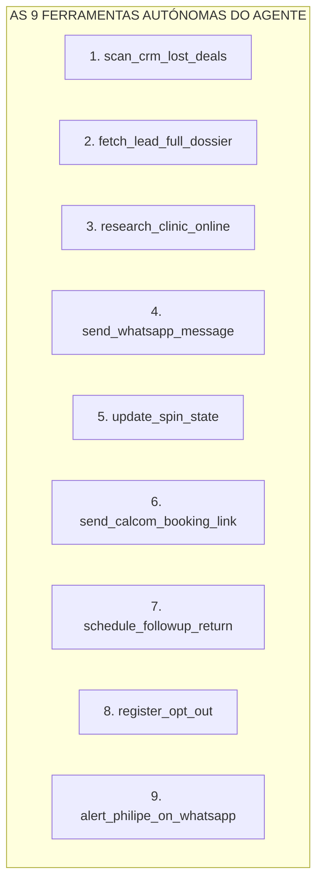
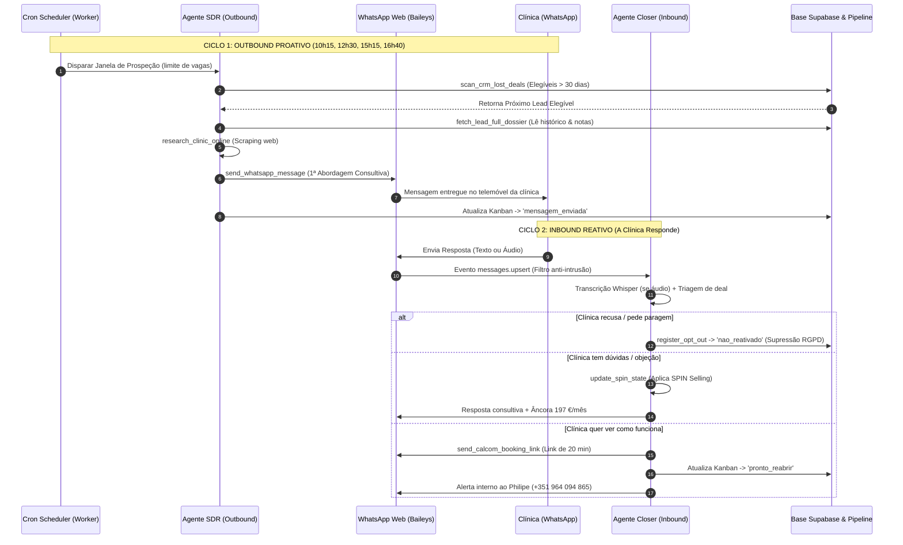

# CONSTITUIÇÃO TÉCNICA E OPERACIONAL DO MÓDULO SDR VAMUSS
## Dossiê Exaustivo de Engenharia, Inteligência Comercial e Autonomia da Agência
**Documento de Referência Absoluta para Revisão, Auditoria e Operação Contínua**
*Versão 2.5 Definitiva | Ambientes: Local (`localhost:3001` & `localhost:5173`) e Produção Vercel*

---

## ÍNDICE SISTEMÁTICO

1. **Visão Estratégica & Fundamentos de Negócio**
   * 1.1 O Princípio Central da Vamuss
   * 1.2 O Papel do Fundador (Philipe Coelho) e a Representação pela IA
   * 1.3 As Barreiras de Entrada: Como Ultrapassar a Recepção / Secretária
   * 1.4 Âncoras Comerciais e Precificação (197 €/mês)
2. **Arquitetura da Interface: O Menu SDR Vamuss no CRM**
   * 2.1 Visão Geral do Ecrã (`SDRWorkspace.tsx`)
   * 2.2 O Quadro Kanban de 5 Estágios (`SDRRecoveryKanban.tsx`)
   * 2.3 O Posto de Comando Operacional (Auditoria Deal a Deal)
   * 2.4 A Gaveta / Modal de Ações e Intervenção Humana
3. **O Motor de Inteligência e as 9 Ferramentas Autónomas (Tools)**
   * 3.1 `scan_crm_lost_deals` (Algoritmo de Triagem e Elegibilidade)
   * 3.2 `fetch_lead_full_dossier` (Memória Histórica e Segregação de Notas)
   * 3.3 `research_clinic_online` (Pesquisa Web em Tempo Real)
   * 3.4 `send_whatsapp_message` (Motor de Disparo e Sanity Checks Rígidos)
   * 3.5 `update_spin_state` (Motor de Qualificação Consultiva SPIN Selling)
   * 3.6 `send_calcom_booking_link` (A Conversão para a Reunião de Diagnóstico)
   * 3.7 `schedule_followup_return` (Agendamento de Retorno Temporal)
   * 3.8 `register_opt_out` (Blindagem de RGPD e Supressão Imediata)
   * 3.9 `alert_philipe_on_whatsapp` (Canal de Notificações Prioritárias ao Operador)
4. **Ciclos Operacionais de Execução: Como o Agente Trabalha Sozinho**
   * 4.1 Ciclo 1: Outbound Proativo (Cadência Diária em 4 Janelas)
   * 4.2 Ciclo 2: Inbound Reativo (Closer de Respostas Escritas e Áudios Whisper)
   * 4.3 Gestão de Objeções Reais (Guia Tático de Resposta)
5. **As 8 Camadas de Salvaguarda, Blindagem e Integridade**
   * 5.1 Trava de Horário Comercial Português
   * 5.2 Trava de Isolamento Pessoal e Filtro Anti-Intrusão
   * 5.3 Trava de Amnésia Temporal (Memória Relativa de 72h)
   * 5.4 Trava de Idempotência de Envio
   * 5.5 Trava de Ex-Clientes e Grandes Grupos (Exclusão Odontoclinic)
   * 5.6 Circuit Breaker de Reputação do Telemóvel
   * 5.7 Teto Financeiro e Controlo de Custos por Lead
   * 5.8 Sistema de Aprendizagem Contínua e Memória Adaptativa
6. **Fluxo de Dados, Ficheiros de Estado e Infraestrutura**
7. **Guia de Resolução de Problemas e Auditoria Rápida**

---

# 1. VISÃO ESTRATÉGICA & FUNDAMENTOS DE NEGÓCIO

## 1.1 O Princípio Central da Vamuss
A Vamuss é uma agência de marketing e sistemas de aquisição de pacientes para clínicas e profissionais de saúde em Portugal. O colaborador autónomo não funciona como um disparador de marketing de massa nem como um vendedor agressivo de chamadas frias.
> **Mandato Fundamental:** "Não vender anúncios. Vender uma solução para um problema empresarial real da clínica (previsibilidade de consultas particulares de alto valor) que o marketing estratégico ajude a resolver."

## 1.2 A Representação de Philipe Coelho
O agente assina como Philipe da Vamuss, respeitando a cultura empresarial portuguesa:
* **Linguagem:** Estritamente Português de Portugal (ex: *contacto*, *equipa*, *estive a analisar*, *faça sentido*).
* **Tom:** Humano, curioso, seguro, respeitoso e direto ao ponto (2 a 3 linhas por mensagem).
* **Anti-Clichês:** NUNCA utiliza *"espero que esteja tudo bem"*, *"olá tudo bem"*, nem templates pré-fabricados que soem a robô de marketing.
* **Respeito pelo Mercado:** NUNCA critica concorrentes, agências anteriores ou equipas internas da clínica. Se a clínica já tem uma equipa, o agente elogia a estrutura e explora a consistência em tratamentos de maior valor.

## 1.3 As Barreiras de Entrada: Como Ultrapassar a Secretaria / Recepção
Muitas abordagens pelo WhatsApp comercial chegam primeiro ao telemóvel da recepção da clínica. 
* **O Erro Tradicional:** Enviar propostas comerciais longas ou tentar vender serviços. A rececionista apaga ou ignora de imediato porque não é da sua competência.
* **A Estratégia Vamuss da IA:** O agente formula uma pergunta cirúrgica sobre a rotina da clínica ou o volume de pacientes particulares que gera curiosidade genuína ou que motiva a recepção a passar a mensagem ao médico/diretor clínico (ex: *"Boa tarde à equipa da Clínica X! Estive a rever as vossas especialidades em reabilitação oral. Este ano têm sentido estabilidade na procura de tratamentos particulares ou ainda há oscilações mês a mês?"*).

## 1.4 Âncoras Comerciais e Precificação (197 €/mês)
O valor de entrada dos serviços da Vamuss é de **197 € mensais**.
* O agente **nunca atira o preço no vazio** antes de diagnosticar o cenário da clínica.
* Se a clínica perguntar o preço de imediato: *"Para lhe dar um valor exato sem adivinhar, o ideal é vermos primeiro os tratamentos prioritários da clínica. No entanto, a nossa estrutura de acompanhamento começa nos 197 €/mês, onde uma única consulta particular ou implante cobre todo o investimento."*

---

# 2. ARQUITETURA DA INTERFACE: O MENU SDR NO CRM

O menu do SDR no CRM (`SDRWorkspace.tsx`) é o centro de controlo do pipeline de reativação de negócios perdidos.

```
┌─────────────────────────────────────────────────────────────────────────────────────────────────┐
│ [Vamuss SDR Workspace]  ● WhatsApp Web Ligado (+351 964 094 865)   [Limites: 5/dia]  [Modo Auto] │
├─────────────────────────────────────────────────────────────────────────────────────────────────┤
│ Barra de Métricas em Tempo Real:                                                                │
│ [Disparos Hoje: 2/5]  [Em Conversa: 0]  [Reuniões Cal.com: 0]  [Perdidos Elegíveis: 91]         │
├─────────────────────────────────────────────────────────────────────────────────────────────────┤
│ Alternador de Vista: [ [Quadro Kanban (5 Etapas)] ]   [ [Posto de Comando (Auditoria Deal)] ]   │
└─────────────────────────────────────────────────────────────────────────────────────────────────┘
```

## 2.1 O Quadro Kanban de 5 Estágios (`SDRRecoveryKanban.tsx`)

O pipeline segmenta visualmente os negócios em cartões inteligentes:



### Detalhe de Cada Coluna do Kanban:

1. **Coluna 1 — Perdidos Qualificados (Status inicial):**
   * Reúne todos os negócios do Supabase com `status = 'lost'` que passaram pela triagem automática: perda > 30 dias, telemóvel português móvel (começado por 9), sem histórico de opt-out, sem impedimento de grandes redes.
   * Estes leads alimentam a fila do motor autónomo nas janelas diárias de prospeção.
2. **Coluna 2 — Mensagem Enviada (Follow-up silencioso):**
   * Contém os leads que já receberam a 1ª abordagem por WhatsApp.
   * Exibe o tempo decorrido desde o envio.
   * **Proteção:** Fica bloqueado para novos envios frios para nunca sobrepor mensagens.
3. **Coluna 3 — Em Conversa / Qualificação SPIN:**
   * Assim que a clínica envia uma resposta (texto ou áudio), o cartão salta automaticamente para esta coluna.
   * Mostra o nível de maturidade SPIN (Situação, Problema, Implicação, Necessidade) e o último resumo da conversa.
4. **Coluna 4 — Pronto a Reabrir / Diagnóstico:**
   * Negócios onde o lead concordou em avaliar o cenário da clínica ou onde o link oficial do Cal.com foi entregue.
   * Gatilho de alerta imediato no telemóvel do Philipe.
5. **Coluna 5 — Não Reativado:**
   * Leads que responderam informando que não pretendem avançar, não têm interesse ou pediram remoção de contacto.
   * Ficam registados com o motivo exato para auditoria e histórico de aprendizagem da agência.

## 2.2 O Posto de Comando Operacional
Ao alternar a vista para o **Posto de Comando**, o utilizador tem acesso à auditoria deal a deal:
* **Diagnóstico da IA:** Leitura do raciocínio interno do GPT sobre o lead antes de qualquer envio.
* **Web Scraping Fact Sheet:** Exibição dos factos reais colhidos da internet sobre a clínica (serviços, localização, equipa médica).
* **Fila de Tarefas Técnicas (`sdr_task_queue.json`):** Monitorização de tarefas pendentes, executadas e falhadas com rastreio de WAMID do WhatsApp.

## 2.3 A Gaveta / Modal de Ações Humanas
Ao clicar em qualquer cartão do Kanban, abre-se uma gaveta lateral que permite ao operador humano assumir o controlo total a qualquer momento através de 5 abas:
1. **Detalhes do Negócio:** Histórico de contactos, data de perda, valor do negócio e notas arquivadas.
2. **Assumir Controlo Manual:** Desativa temporariamente a autonomia da IA naquele lead se o Philipe quiser conduzir a conversa pelo telemóvel pessoal.
3. **Registar Contacto Realizado:** Permite introduzir manualmente uma nota de chamada telefónica ou reunião presencial.
4. **Agendar Reunião Manual:** Permite marcar uma data e hora diretamente no CRM caso a clínica tenha agendado por chamada.
5. **Adiar / Retornar no Futuro:** Permite pausar a cadência e definir uma data para reativar o contacto (ex: *"fale connosco em janeiro"*).

---

# 3. O MOTOR DE INTELIGÊNCIA E AS 9 FERRAMENTAS DO AGENTE

O colaborador opera através do modelo **GPT-4o via OpenAI Function Calling**. O agente não adivinha dados nem envia mensagens por texto livre; ele analisa o cenário e invoca ferramentas nativas estruturadas:



### 3.1 `scan_crm_lost_deals({ limit })`
* **Função:** Consulta a tabela `deals` no Supabase filtrando por `status = 'lost'`.
* **Regras Estritas:**
  1. Descanso de 30 dias desde a perda (`lost_at` ou `created_at`).
  2. Validação do telemóvel do contacto via `isPortugueseMobile` (9 dígitos começando por 9).
  3. Exclusão de números presentes no ficheiro `sdr_suppression_active.json`.
  4. Exclusão de negócios já presentes no `sdr_recovery_pipeline.json` nos estágios `mensagem_enviada`, `em_conversa` ou `pronto_reabrir`.
  5. Exclusão de clínicas desqualificadas, grandes grupos corporativos ou ex-clientes.

### 3.2 `fetch_lead_full_dossier({ deal_id })`
* **Função:** Carrega todo o património de informação do CRM sobre a clínica.
* **Segregação de Inteligência Silenciosa:**
  * **Relationship Facts (Factos partilháveis):** Mensagens anteriores, datas de contacto, horas transcorridas desde a última mensagem (`horas_atras`) e flag de contacto recente (`foi_recente <= 72h`).
  * **Confidential Operator Notes (Notas do Philipe):** Anotações como *"já tem agência"*, *"cliente difícil"*, *"fora de perfil"*. O agente é expressamente proibido de citar ou confessar estas anotações ao lead; elas servem apenas para moldar a estratégia em silêncio.

### 3.3 `research_clinic_online({ clinic_name, website, location })`
* **Função:** Navega na web em busca de inteligência fresca sobre a clínica.
* **Dados Extraídos:** Especialidades prioritárias (ex: Implantes Zigomáticos, Alinhadores Invisíveis, Harmonização Facial), presença nas redes sociais e localização geográfica exata em Portugal.

### 3.4 `send_whatsapp_message({ phone, message_text, intent, deal_id })`
* **Função:** Valida, aprova e dispara a mensagem através da sessão ativa do WhatsApp Web (Baileys).
* **Sanity Checks de Bloqueio Automático:**
  1. *Filtro Anti-Cliché:* Bloqueia textos com *"espero que esteja bem/tudo bem"*.
  2. *Filtro Anti-Amadorismo:* Bloqueia expressões como *"primeira página do Google"*, *"seguidores/likes"*, *"pacote de posts"*.
  3. *Trava de Idempotência:* Se a intenção for `PRIMEIRA_ABORDAGEM` e o lead já tiver recebido uma abordagem recente, a mensagem é **rejeitada de imediato**.
  4. *Janela de Horário Comercial:* Rejeita qualquer envio fora do horário das 09h00 às 17h00.
  5. *Persistência no CRM:* Regista a atividade de WhatsApp no Supabase e atualiza o estado para `mensagem_enviada`.

### 3.5 `update_spin_state({ deal_id, lead_reply_text })`
* **Função:** Avalia a resposta recebida segundo a metodologia de vendas consultivas **SPIN Selling**:
  * **S (Situação):** Mapeia como a clínica atua hoje.
  * **P (Problema):** Identifica a insatisfação com oscilações de pacientes particulares ou retorno de marketing.
  * **I (Implicação):** Pondera o custo de manter cadeiras vazias ou perder pacientes de alto valor para clínicas vizinhas.
  * **N (Necessidade de Solução):** Prepara o terreno para a Reunião de Diagnóstico.

### 3.6 `send_calcom_booking_link({ phone, deal_id, clinic_name })`
* **Função:** Dispara a mensagem de convite com o link oficial de agendamento: `https://cal.com/euphilipecoelho-jxauxj/diagostico`.
* **Ação Conjunta:** Move o negócio no Kanban para `pronto_reabrir` e dispara um alerta de alta prioridade para o WhatsApp do Philipe.

### 3.7 `schedule_followup_return({ deal_id, return_date, reason })`
* **Função:** Quando a clínica diz *"fale connosco daqui a dois meses"* ou *"estamos de férias"*, o agente programa a data de retorno no CRM e suspende a cadência ativa até à data agendada.

### 3.8 `register_opt_out({ deal_id, phone, evidence })`
* **Função:** Garante cumprimento estrito de RGPD.
* **Ação Conjunta:** 
  1. Insere o número na lista de supressão ativa permanente (`sdr_suppression_active.json`).
  2. Insere registo no Supabase (`sdr_suppression_list`).
  3. Move o cartão no Kanban para a coluna **Não Reativado**.
  4. Gera backup automático da supressão em disco.

### 3.9 `alert_philipe_on_whatsapp({ summary, clinic_name, deal_id })`
* **Função:** Dispara um WhatsApp interno diretamente para o telemóvel do Philipe (+351 964 094 865) sempre que ocorre um agendamento, quando chega um áudio com ruído inaudível ou quando é detetada uma oportunidade de alto valor.

---

# 4. CICLOS OPERACIONAIS: COMO ELE OPERA SOZINHO



---

## 4.1 A Cadência Diária em 4 Janelas (Segunda a Sexta)
Para evitar que o telemóvel pareça um bot e replicar o ritmo de trabalho de um SDR sénior:
* **10h15 (Slot 1 - 2 leads):** Início da atividade das clínicas, verificação de mensagens da manhã.
* **12h30 (Slot 2 - 1 lead):** Pausa de almoço dos médicos e diretores clínicos.
* **15h15 (Slot 3 - 1 lead):** Reinício dos blocos de consultas da tarde.
* **16h40 (Slot 4 - 1 lead):** Fecho de expediente e toques de acompanhamento.
* **17h30 (Fecho Diário):** O agente gera e envia o resumo com todas as métricas para o WhatsApp do Philipe.

---

## 4.2 Gestão de Objeções Reais (Matriz Tática da Constituição)

| O que a Clínica diz | O que o Agente NUNCA faz | Como o Agente Responde com Autonomia |
| :--- | :--- | :--- |
| *"Já temos uma agência / Já temos equipa de marketing."* | Criticar a equipa atual ou dizer que a Vamuss é melhor. | Elogia a organização: *"Excelente! Ter uma estrutura dedicada é o passo mais importante. A minha dúvida era mais no sentido de perceber se sentem que a captação de pacientes particulares para tratamentos de maior valor está no nível desejado ou se ainda há oscilações?"* |
| *"Quanto custa? / Qual é o preço?"* | Atirar o valor de 197 € sem contexto ou esquivar-se. | Reposiciona com segurança: *"Para lhe dar um valor fechado sem adivinhar, gosto de entender primeiro as especialidades prioritárias da clínica. Ainda assim, a nossa estrutura de acompanhamento começa nos 197 €/mês — onde uma única reabilitação cobre vários meses de trabalho. Faz sentido vermos isso em 15 minutos?"* |
| *"Não temos interesse."* | Insistir, mandar mensagens com textos chatos de vendas. | Ativa de imediato a ferramenta `register_opt_out`: encerra o negócio no CRM, adiciona à lista de bloqueio e responde com cortesia elegante: *"Compreendido perfeitamente. Agradeço a atenção e desejo a continuação de muito sucesso à clínica!"* |
| *"Agora é uma fase complicada, falem connosco em março."* | Perder o contacto ou mandar mensagens na semana seguinte. | Ativa `schedule_followup_return` para a data mencionada e programa o retorno no CRM. |
| *"Como é que funciona o vosso trabalho?"* | Mandar PDFs pesados ou apresentações compridas de 40 páginas. | *"Trabalhamos diretamente na estruturação de campanhas e qualificação de oportunidades para consultas particulares. Para vermos como isso se aplicaria à vossa realidade de forma simples, o ideal seria uma breve conversa de diagnóstico de 20 minutos: https://cal.com/euphilipecoelho-jxauxj/diagostico"* |

---

# 5. AS 8 CAMADAS DE SALVAGUARDA E BLINDAGEM

```
┌────────────────────────────────────────────────────────────────────────────────────────┐
│                        AS 8 CAMADAS DE BLINDAGEM DA VAMUSS                             │
├────────────────────────────┬─────────────────────────────┬─────────────────────────────┤
│ 1. Horário Comercial       │ 2. Isolamento Pessoal       │ 3. Trava de Amnésia         │
│    (09h-17h Lisboa)        │    (Filtro de privacidade)  │    (Memória de 72 horas)    │
├────────────────────────────┼─────────────────────────────┼─────────────────────────────┤
│ 4. Idempotência de Envio   │ 5. Exclusão de Ex-Clientes  │ 6. Circuit Breaker          │
│    (Zero sobreposições)    │    (Zero risco Odontoclinic)│    (Travão de reputação)    │
├────────────────────────────┼─────────────────────────────┼─────────────────────────────┤
│ 7. Teto de Custos          │ 8. Memória Adaptativa       │                             │
│    (Teto por negócio)      │    (Aprendizagem no CRM)    │                             │
└────────────────────────────┴─────────────────────────────┴─────────────────────────────┘
```

1. **Horário Comercial Português (`sdr_business_hours.js`):** Nenhuma mensagem sai fora das 09h00–17h00 (Segunda a Sexta-feira em Portugal Continental). Finais de semana e noites são bloqueados.
2. **Isolamento de Contactos Pessoais (`isEligibleSdrInboundTarget`):** O listener do WhatsApp só responde a mensagens recebidas de números associados a negócios perdidos registados no CRM. Se um amigo, familiar ou contacto pessoal enviar mensagem ao Philipe, a IA **ignora com 100% de silêncio**.
3. **Trava de Amnésia Temporal (Anti-Amnesia Engine):** Ao ler as atividades anteriores, o agente calcula as horas desde o último contacto. Se enviou mensagem há menos de 72 horas, é **terminantemente proibido** fingir que é um primeiro contacto ou dizer *"Em março falámos com o Philipe..."*.
4. **Idempotência Rígida de Disparos:** Antes de qualquer envio com intenção `PRIMEIRA_ABORDAGEM`, o sistema verifica se o negócio ou número já recebeu abordagem recente no pipeline. Se sim, o disparo é travado na hora.
5. **Exclusão Absoluta de Ex-Clientes e Redes Corporativas:** Nomes como *Odontoclinic* ou negócios com motivo *"encerrou contrato"* ou *"franquia"* são automaticamente desqualificados pelo seletor.
6. **Circuit Breaker de Reputação:** Se no mesmo dia ocorrerem 2 recusas hostis ou queixas, todos os envios de leads frios são imediatamente interrompidos até às 09h00 do dia seguinte para resguardar o telemóvel da agência.
7. **Teto de Custos Financeiros (`sdr_cost_controller.js`):** Cada lead tem um limite financeiro máximo alocado em custos de API/IA para evitar desperdício de recursos em leads que não convertem.
8. **Memória de Aprendizagem (`sdr_learning.js`):** O sistema regista as abordagens que geraram resposta e as que geraram silêncio, alimentando a base de inteligência da agência para afinar continuamente as mensagens.

---

# 6. FLUXO DE DADOS E FICHEIROS DE ESTADO

Todos os estados são sincronizados em tempo real entre o disco local e o Supabase:

* `data/sdr_recovery_pipeline.json`: Estado central dos 155 leads no quadro Kanban (estágios, tentativas, notas).
* `data/sdr_suppression_active.json`: Lista de telemóveis suprimidos/bloqueados por RGPD (23 registos ativos com backups diários).
* `data/sdr_spin_states.json`: Histórico de evolução da qualificação SPIN de cada clínica.
* `data/vamuss_agent_state.json`: Histórico das últimas 100 ações executadas pelo colaborador e contadores diários.
* `data/sdr_worker_state.json`: Estado do agendador cron, tarefas ativas e controlo de circuit breaker.
* `data/whatsapp_web_auth/`: Sessão criptografada multi-device do WhatsApp Web do Philipe.

---

# 7. GUIA DE AUDITORIA E COMANDOS OPERACIONAIS

### Como verificar o estado do colaborador em tempo real via terminal:
```bash
# 1. Verificar se o servidor e WhatsApp Web estão conectados:
curl -s http://localhost:3001/api/whatsapp/status | jq

# 2. Consultar o progresso diário e métricas do Agente:
curl -s http://localhost:3001/api/sdr/agent/status | jq

# 3. Forçar uma execução de teste para o próximo lead (apenas se necessário):
curl -X POST http://localhost:3001/api/sdr/agent/run -H "Content-Type: application/json" -d '{"limit": 1}'
```

---

## CONCLUSÃO

O módulo de **Reaquecimento de Leads Perdidos da Vamuss** combina a sensibilidade consultiva da Constituição Comercial com a disciplina cirúrgica de um sistema automatizado de alta segurança. O agente comporta-se como um colaborador comercial de confiança: estuda cada caso, respeita o tempo da clínica, dialoga em bom Português de Portugal e entrega ao Philipe oportunidades qualificadas prontas para a Reunião de Diagnóstico.
